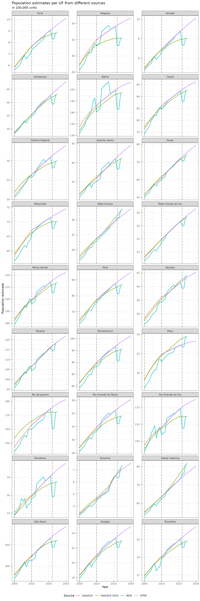
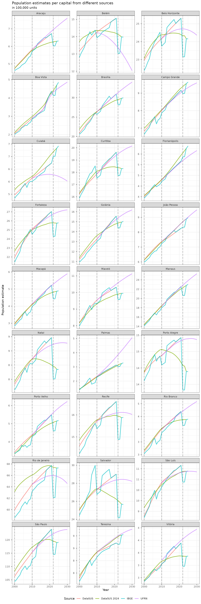

# Population estimates comparison

This article compares the population series available in `brpop`.

DataSUS (the Brazilian Ministry of Health) provides the original
2000–2021 series and the revised 2000–2024 series by municipality, sex,
and age group. UFRN-PPGDem-LEPP provides projections from 2010 to 2030
at the same level of detail. The IBGE series combines census,
population-count, and annual-estimate values for municipality totals
from 2000 to 2025.

The sources use different methods and should not be treated as
interchangeable. The plots below make their levels and trends easier to
compare.

``` r

library(dplyr)
library(tibble)
library(ggplot2)
library(scales)
library(brpop)
```

``` r

names_helper <- tibble(
  uf_code = c(
    "11",
    "12",
    "13",
    "14",
    "15",
    "16",
    "17",
    "21",
    "22",
    "23",
    "24",
    "25",
    "26",
    "27",
    "28",
    "29",
    "31",
    "32",
    "33",
    "35",
    "41",
    "42",
    "43",
    "50",
    "51",
    "52",
    "53"
  ),
  uf_name = c(
    "Rondônia",
    "Acre",
    "Amazonas",
    "Roraima",
    "Pará",
    "Amapá",
    "Tocantins",
    "Maranhão",
    "Piauí",
    "Ceará",
    "Rio Grande do Norte",
    "Paraíba",
    "Pernambuco",
    "Alagoas",
    "Sergipe",
    "Bahia",
    "Minas Gerais",
    "Espírito Santo",
    "Rio de Janeiro",
    "São Paulo",
    "Paraná",
    "Santa Catarina",
    "Rio Grande do Sul",
    "Mato Grosso do Sul",
    "Mato Grosso",
    "Goiás",
    "Distrito Federal"
  ),
  cap_code7 = c(
    1100205,
    1200401,
    1302603,
    1400100,
    1501402,
    1600303,
    1721000,
    2111300,
    2211001,
    2304400,
    2408102,
    2507507,
    2611606,
    2704302,
    2800308,
    2927408,
    3106200,
    3205309,
    3304557,
    3550308,
    4106902,
    4205407,
    4314902,
    5002704,
    5103403,
    5208707,
    5300108
  ),
  cap_code6 = c(
    110020,
    120040,
    130260,
    140010,
    150140,
    160030,
    172100,
    211130,
    221100,
    230440,
    240810,
    250750,
    261160,
    270430,
    280030,
    292740,
    310620,
    320530,
    330455,
    355030,
    410690,
    420540,
    431490,
    500270,
    510340,
    520870,
    530010
  ),
  cap_name = c(
    "Porto Velho",
    "Rio Branco",
    "Manaus",
    "Boa Vista",
    "Belém",
    "Macapá",
    "Palmas",
    "São Luís",
    "Teresina",
    "Fortaleza",
    "Natal",
    "João Pessoa",
    "Recife",
    "Maceió",
    "Aracaju",
    "Salvador",
    "Belo Horizonte",
    "Vitória",
    "Rio de Janeiro",
    "São Paulo",
    "Curitiba",
    "Florianópolis",
    "Porto Alegre",
    "Campo Grande",
    "Cuiabá",
    "Goiânia",
    "Brasília"
  )
)
```

## Total population per UF

``` r

datasus_pop_uf <- uf_pop_totals(source = "datasus") |>
  mutate(source = "DataSUS") |>
  filter(uf != "5e")
#> Setting `max_tries = 2`.
#> Setting `max_tries = 2`.

ufrn_pop_uf <- uf_pop_totals(source = "ufrn") |>
  mutate(source = "UFRN")
#> Setting `max_tries = 2`.
#> Setting `max_tries = 2`.

ibge_pop_uf <- uf_pop_totals(source = "ibge") |>
  mutate(source = "IBGE")

datasus2024_pop_uf <- uf_pop_totals(source = "datasus2024") |>
  mutate(source = "DataSUS 2024")
#> Setting `max_tries = 2`.
#> Setting `max_tries = 2`.

bind_rows(datasus_pop_uf, ufrn_pop_uf, ibge_pop_uf, datasus2024_pop_uf) |>
  left_join(names_helper, by = c("uf" = "uf_code")) |>
  ggplot(aes(x = year, y = pop, color = source, group = source)) +
  geom_line(stat = "identity", alpha = .7, lwd = 1) +
  geom_vline(
    xintercept = c(2000, 2010, 2022),
    alpha = .5,
    linetype = "longdash"
  ) +
  scale_y_continuous(
    labels = unit_format(accuracy = 1, scale = 0.00001, unit = NULL)
  ) +
  facet_wrap(~uf_name, scales = "free_y", ncol = 3) +
  theme_bw() +
  theme(legend.position = "bottom", legend.direction = "horizontal") +
  labs(
    title = "Population estimates per UF from different sources",
    subtitle = "in 100,000 units",
    color = "Source",
    x = "Year",
    y = "Population estimate"
  )
```



## Total population per capitals

``` r

datasus_pop_mun <- mun_pop_totals(source = "datasus") |>
  mutate(source = "DataSUS") |>
  right_join(names_helper, by = c("code_muni" = "cap_code6"))

ufrn_pop_mun <- mun_pop_totals(source = "ufrn") |>
  mutate(source = "UFRN") |>
  right_join(names_helper, by = c("code_muni" = "cap_code7"))

ibge_pop_mun <- mun_pop_totals(source = "ibge") |>
  mutate(source = "IBGE") |>
  right_join(names_helper, by = c("code_muni" = "cap_code7"))

datasus2024_pop_mun <- mun_pop_totals(source = "datasus2024") |>
  mutate(source = "DataSUS 2024") |>
  right_join(names_helper, by = c("code_muni" = "cap_code7"))

bind_rows(datasus_pop_mun, ufrn_pop_mun, ibge_pop_mun, datasus2024_pop_mun) |>
  ggplot(aes(x = year, y = pop, color = source, group = source)) +
  geom_line(stat = "identity", alpha = .7, lwd = 1) +
  geom_vline(
    xintercept = c(2000, 2010, 2022),
    alpha = .5,
    linetype = "longdash"
  ) +
  scale_y_continuous(
    labels = unit_format(accuracy = 1, scale = 0.00001, unit = NULL)
  ) +
  facet_wrap(~cap_name, scales = "free_y", ncol = 3) +
  theme_bw() +
  theme(legend.position = "bottom", legend.direction = "horizontal") +
  labs(
    title = "Population estimates per capital from different sources",
    subtitle = "in 100,000 units",
    color = "Source",
    x = "Year",
    y = "Population estimate"
  )
```



## Session info

``` r

sessionInfo()
#> R version 4.6.1 (2026-06-24)
#> Platform: x86_64-pc-linux-gnu
#> Running under: Ubuntu 24.04.4 LTS
#> 
#> Matrix products: default
#> BLAS:   /usr/lib/x86_64-linux-gnu/openblas-pthread/libblas.so.3 
#> LAPACK: /usr/lib/x86_64-linux-gnu/openblas-pthread/libopenblasp-r0.3.26.so;  LAPACK version 3.12.0
#> 
#> locale:
#>  [1] LC_CTYPE=C.UTF-8       LC_NUMERIC=C           LC_TIME=C.UTF-8       
#>  [4] LC_COLLATE=C.UTF-8     LC_MONETARY=C.UTF-8    LC_MESSAGES=C.UTF-8   
#>  [7] LC_PAPER=C.UTF-8       LC_NAME=C              LC_ADDRESS=C          
#> [10] LC_TELEPHONE=C         LC_MEASUREMENT=C.UTF-8 LC_IDENTIFICATION=C   
#> 
#> time zone: UTC
#> tzcode source: system (glibc)
#> 
#> attached base packages:
#> [1] stats     graphics  grDevices utils     datasets  methods   base     
#> 
#> other attached packages:
#> [1] brpop_0.7.0   scales_1.4.0  ggplot2_4.0.3 tibble_3.3.1  dplyr_1.2.1  
#> 
#> loaded via a namespace (and not attached):
#>  [1] gtable_0.3.6       jsonlite_2.0.0     compiler_4.6.1     tidyselect_1.2.1  
#>  [5] zendown_0.1.0      bitops_1.0-9       tidyr_1.3.2        jquerylib_0.1.4   
#>  [9] systemfonts_1.3.2  textshaping_1.0.5  yaml_2.3.12        fastmap_1.2.0     
#> [13] dtplyr_1.3.3       R6_2.6.1           labeling_0.4.3     generics_0.1.4    
#> [17] curl_7.1.0         httr2_1.3.0        knitr_1.51         backports_1.5.1   
#> [21] checkmate_2.3.4    desc_1.4.3         bslib_0.11.0       pillar_1.11.1     
#> [25] RColorBrewer_1.1-3 rlang_1.3.0        cachem_1.1.0       xfun_0.60         
#> [29] fs_2.1.0           sass_0.4.10        S7_0.2.2           otel_0.2.0        
#> [33] cli_3.6.6          pkgdown_2.2.1      withr_3.0.3        magrittr_2.0.5    
#> [37] digest_0.6.39      grid_4.6.1         lifecycle_1.0.5    vctrs_0.7.3       
#> [41] data.table_1.18.4  evaluate_1.0.5     glue_1.8.1         farver_2.1.2      
#> [45] ragg_1.5.2         RCurl_1.98-1.19    purrr_1.2.2        rmarkdown_2.31    
#> [49] tools_4.6.1        pkgconfig_2.0.3    htmltools_0.5.9
```
